# Project Overview

## Project Name

Genesis simulation 기반 digital twin 생성

## Key Features

- 다양한 로봇 로드 가능
    - (표준 ROS2 메시지 ↔ 시뮬레이터 액추에이터 변환 레이어 구현을 통해 다양한 로봇 로드 가능)
    - ros 패키지가 없는 로봇의 경우에도 쉽게 클래스 확장을 통해 지원
- 시뮬레이터와 teleop 프로세스 분리
    - tcp/ip 형태로 시뮬레이터 접속 가능
    - teleop process의 initialize 시점에 시뮬레이터 내에 robot instance 할당
    - 사용자는 browser를 통해 접속 가능



기본적인 동작은
```
genesis simulator <--> teleop server <--> browser

genesis simulator <--> teleop server : tcp/ip (ZeroMQ)
teleop server <--> browser : WebRTC (비디오 스트림) + WebSocket (제어 명령)
```

> **스트리밍 방식 변경 시 영향 범위**: teleop server의 스트리밍 모듈과 브라우저 클라이언트 코드만 교체하면 되며, simulator ↔ teleop server 구간(ZeroMQ)은 영향 없음. 스트리밍 컴포넌트를 모듈로 분리해두면 추후 변경이 용이함.

## Multi-user 정책

- 모든 클라이언트는 **동일한 scene을 공유**
- **인증 없이 익명**으로 접속
- 클라이언트 접속 시 scene 내에 해당 클라이언트 전용 object/robot 인스턴스 자동 생성
- 클라이언트 연결 종료 시 해당 인스턴스는 scene에서 **즉시 삭제**

## 성능 목표 및 환경

- GPU: RTX 4090
- 목표 프레임: **사용자당 30fps**
- 해상도: 필요시 낮춰도 무방 (latency/fps 확보 우선)
- Genesis는 headless 렌더링을 지원하나, **다중 클라이언트 동시 렌더링은 직접 지원하지 않으므로 우회 구현 필요**
    - 예: 클라이언트별 독립 카메라 인스턴스 생성 후 각 프레임을 별도 인코딩하여 전송

## Plan

Step 1. Genesis에서 ground plane만 있는 blank scene을 headless 렌더링하고, teleop 서버가 이를 받아 WebRTC로 브라우저에 스트리밍하는 전체 파이프라인 검증.
Step 2. Genesis 내에 임의의 object (e.g. simple box) 구현 후 client가 wasd 방향키로 object 이동 가능하도록 만들기.
Step 3. 두명이 접속 요청시 자동으로 object 생성 후 각자의 object를 teleop 가능하도록 하기. 연결 종료 시 인스턴스 삭제.
Step 4. 단순 object가 아니라 복잡한 로봇이 가능하도록 만들기.
Step 5. general robot 지원 가능하도록 ROS2 인터페이스 만들기.
    - IsaacLab의 ROS2 지원 방식처럼, 표준 ROS2 토픽(e.g. `geometry_msgs/Twist`, `sensor_msgs/JointState`)을 pub/sub하는 브릿지 레이어 구현
    - 시뮬레이터가 ROS2 node처럼 동작하여 실제 ROS2 환경과 연동 가능하게 함
    - ROS2 패키지가 없는 로봇도 클래스 확장으로 커버

## 추후 고려 사항 (현재 스코프 외)

- Digital twin 양방향 동기화: 외부 센서/VLM 데이터를 시뮬레이션에 반영하거나, 시뮬레이션 상태를 실제 로봇에 피드백하는 기능
